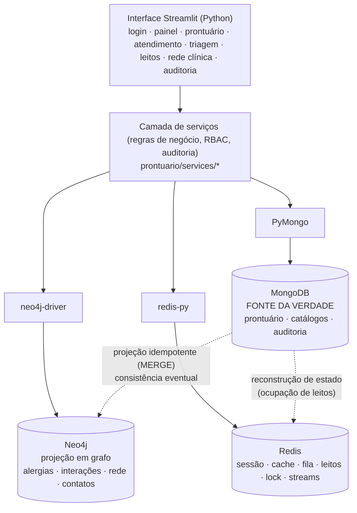
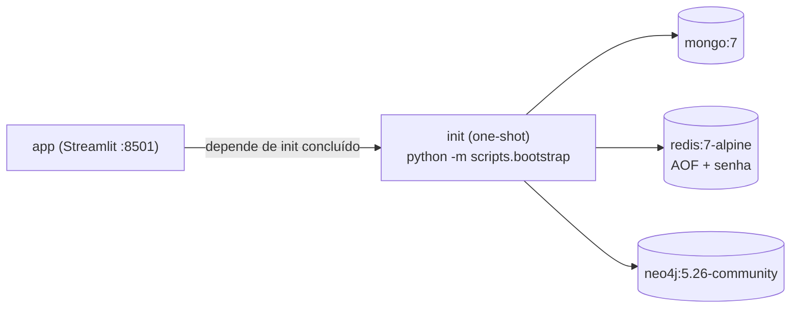
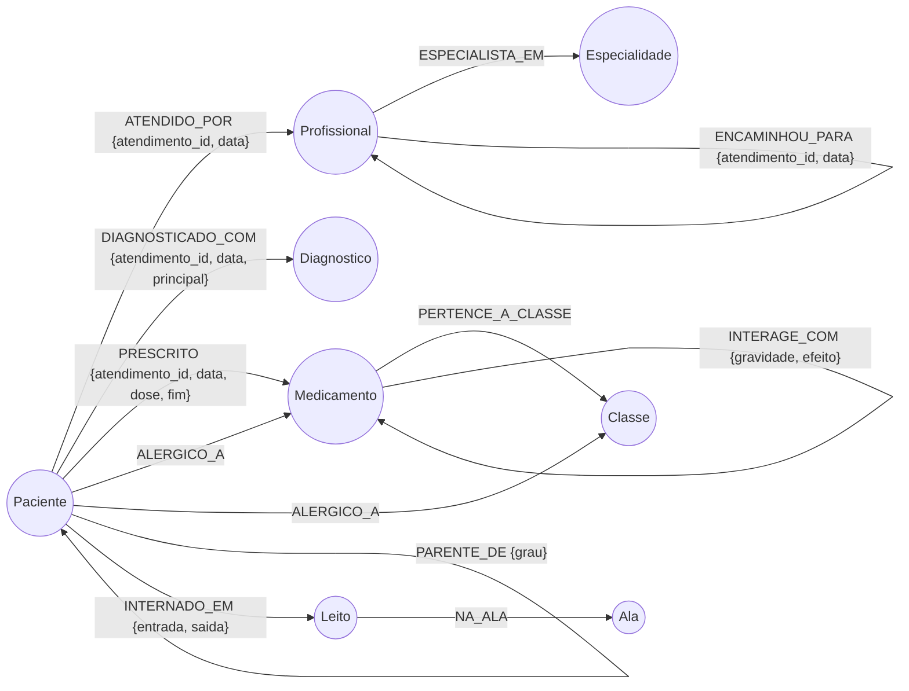
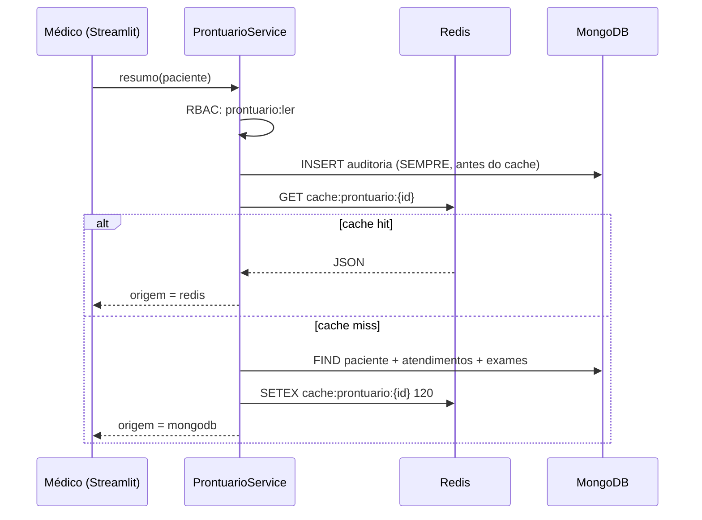
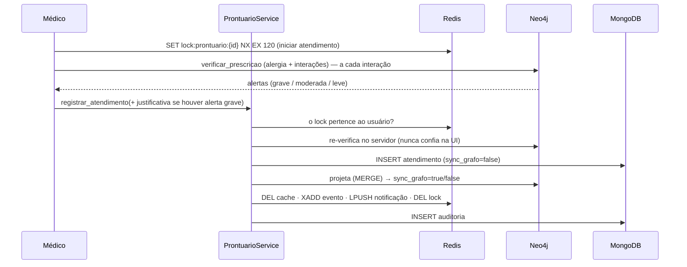

# Prontuário Eletrônico Hospitalar — Persistência Poliglota (MongoDB · Redis · Neo4j)

Projeto final da disciplina **Implementação de Bancos de Dados NoSQL** (Prof. Ricardo Roberto de Lima).
Aplicação **Python + Streamlit** que gerencia **prontuários hospitalares** integrando três bancos NoSQL, cada um
usado no que faz de melhor:

| Banco | Modelo | Papel neste sistema |
|---|---|---|
| **MongoDB 7** | Documentos | **Fonte da verdade** clínica: pacientes, atendimentos (prontuário), exames, internações, catálogos e **auditoria** |
| **Redis 7** | Chave-valor / in-memory | Sessões, **cache** do prontuário (TTL + invalidação), **fila de triagem**, **ocupação de leitos**, **lock de edição**, notificações e eventos |
| **Neo4j 5** | Grafos | **Segurança da prescrição** (alergias e interações), condutas em pacientes similares, risco hereditário, rede de encaminhamento (`shortestPath`) e **rastreio de contatos** hospitalares |

> **Aviso:** todos os dados são **sintéticos** (nomes, CPFs e prontuários fictícios) e os catálogos de CID-10,
> medicamentos e interações são **didáticos**. O sistema é um projeto acadêmico e **não substitui** software clínico
> certificado nem o julgamento de um profissional de saúde.

---

## Sumário

1. [Contexto e problema de negócio](#1-contexto-e-problema-de-negócio)
2. [Aderência ao manual do projeto](#2-aderência-ao-manual-do-projeto)
3. [Arquitetura](#3-arquitetura)
4. [Qual dado vai para qual banco — e por quê](#4-qual-dado-vai-para-qual-banco--e-por-quê)
5. [Modelagem — MongoDB](#5-modelagem--mongodb)
6. [Modelagem — Redis](#6-modelagem--redis)
7. [Modelagem — Neo4j e Cypher](#7-modelagem--neo4j-e-cypher)
8. [Fluxos ponta a ponta](#8-fluxos-ponta-a-ponta)
9. [Consistência, falhas e recuperação](#9-consistência-falhas-e-recuperação)
10. [Segurança, privacidade e conformidade](#10-segurança-privacidade-e-conformidade)
11. [Telas da aplicação](#11-telas-da-aplicação)
12. [Como executar](#12-como-executar)
13. [Roteiro de demonstração (defesa oral)](#13-roteiro-de-demonstração-defesa-oral)
14. [Estrutura do repositório](#14-estrutura-do-repositório)
15. [Testes e verificação](#15-testes-e-verificação)
16. [Perguntas prováveis da arguição](#16-perguntas-prováveis-da-arguição)
17. [Limitações conhecidas e próximos passos](#17-limitações-conhecidas-e-próximos-passos)
18. [Equipe](#18-equipe)

---

## 1. Contexto e problema de negócio

Um hospital precisa registrar, consultar e proteger o histórico clínico de cada paciente, e ao mesmo tempo operar
o dia a dia assistencial. Esses requisitos têm **perfis de acesso a dados muito diferentes**:

| Necessidade | Característica | Banco escolhido |
|---|---|---|
| O prontuário é um registro **semi-estruturado e heterogêneo** (anamnese, sinais vitais, prescrições, exames de laboratório *e* de imagem com formatos diferentes) | Esquema flexível, documentos aninhados, consultas por paciente/data/CID, agregações | **MongoDB** |
| Triagem em pronto-socorro, ocupação de leitos, sessões e abertura repetida do mesmo prontuário | Latência de milissegundos, estruturas atômicas, expiração automática | **Redis** |
| "Este medicamento conflita com algo que o paciente já usa ou com sua alergia?", "quem esteve na mesma ala que o caso de COVID?", "qual o caminho de encaminhamento da Emergência até a Nefrologia?" | Travessia de **relacionamentos** em vários saltos | **Neo4j** |

**Problemas que o sistema resolve**

1. **Segurança do paciente** — alerta de alergia (inclusive por *classe* de medicamento) e de interação medicamentosa **antes** de salvar a prescrição.
2. **Continuidade do cuidado** — linha do tempo completa por paciente, com adendos que preservam o registro original.
3. **Operação hospitalar** — fila de triagem por prioridade (Manchester) em tempo real e mapa de leitos sem dupla ocupação.
4. **Vigilância epidemiológica** — rastreio de contatos hospitalares por sobreposição de internações na mesma ala.
5. **Conformidade** — auditoria de **todo** acesso a dado de saúde, controle de acesso por perfil e minimização de dados (LGPD).

---

## 2. Aderência ao manual do projeto

> **Nota para o grupo:** o manual oferece dois estudos de caso (E-commerce e Rede Profissional) e exige escolher um.
> Este projeto implementa um **caso de uso próprio (prontuário hospitalar)** que reproduz *exatamente a mesma divisão de
> responsabilidades* exigida pelo manual (documento + chave-valor/cache/sessão + grafo/recomendação/`shortestPath`).
> **Confirme com o professor a aceitação do caso de uso** antes da defesa; a tabela abaixo facilita o mapeamento.

| Exigência do manual | Onde está no projeto |
|---|---|
| Python + Streamlit orquestrando os 3 bancos | `streamlit_app.py`, `prontuario/ui/`, drivers em `prontuario/infra/` |
| **MongoDB**: dados estruturados/semi-estruturados, catálogos e históricos | §5 — `pacientes`, `atendimentos`, `exames`, `internacoes`, `medicamentos`, `cid10`, `auditoria`… |
| **Redis**: sessões, estado em tempo real, cache de leituras (TTL / invalidação) | §6 — sessão deslizante, cache-aside do prontuário, fila de triagem, leitos, lock, streams |
| **Neo4j**: conexões, rotas, recomendação, *Index-Free Adjacency* | §7 — filtragem colaborativa (como o exemplo do manual), `shortestPath`, travessias |
| Repositório organizado, comentado, com `requirements.txt` **ou** Docker Compose | `requirements.txt`, `Dockerfile`, `docker-compose.yml` |
| Scripts de criação de schemas/índices e carga inicial nos 3 bancos | `scripts/bootstrap.py`, `scripts/seed.py`, `scripts/sync_grafo.py` |
| Conexão Neo4j local **ou** AuraDB via variáveis de ambiente | `.env.example` (`NEO4J_URI`, `NEO4J_USERNAME`, `NEO4J_PASSWORD`, `NEO4J_DATABASE`) — ver [§12.4](#124-usando-o-neo4j-auradb) |
| Telas mínimas, fluxo mostrando os 3 bancos ao mesmo tempo | §11 + **Console poliglota** na barra lateral (mostra, ao vivo, a operação em cada banco) |
| Defesa oral (arquitetura, modelagem, demo, arguição) | §13 (roteiro cronometrado) e §16 (perguntas prováveis) |

**Matriz de avaliação → evidências**

| Critério (peso) | O que mostrar |
|---|---|
| Integração arquitetural NoSQL (25%) | §3 e §4: cada dado no banco mais adequado; Mongo = verdade, Redis/Neo4j = derivados e reconstruíveis |
| Modelagem & Cypher (20%) | §5–§7: validação `$jsonSchema`, índices, chaves/TTLs do Redis, 6 consultas Cypher comentadas |
| Streamlit & Python (25%) | §11/§14: 10 telas, camada de serviços testada (57 testes), tratamento de erros sem *stack trace* na UI |
| Defesa oral (30%) | §13 e §16 |

---

## 3. Arquitetura



Princípios de projeto:

* **Uma fonte da verdade.** Todo dado clínico é gravado primeiro no MongoDB. O que está no Redis é cache ou estado efêmero; o que está no Neo4j é uma **projeção** reconstruível (`python -m scripts.sync_grafo --todos`).
* **Camadas.** A UI não toca bancos: chama serviços (`prontuario/services`). Os serviços recebem os bancos por **injeção de dependência** (`container.montar`), o que permite testar com `mongomock`, `fakeredis` e um grafo falso.
* **Falhar com segurança.** Auditoria é *fail-closed* (sem log, sem acesso); Neo4j fora do ar **não** bloqueia o registro clínico (consistência eventual), mas exige justificativa para prescrever sem a checagem de segurança.
* **Sem segredos no código.** Toda configuração vem de variáveis de ambiente (`.env`).

### Componentes do Docker Compose



---

## 4. Qual dado vai para qual banco — e por quê

| Dado | Banco | Estrutura | Justificativa |
|---|---|---|---|
| Paciente (cadastro, alergias, familiares) | MongoDB | Documento | Atributos variáveis e listas aninhadas (alergias, contatos) leem-se como uma unidade |
| **Atendimento** (queixa, sinais vitais, diagnósticos CID, prescrições, evolução) | MongoDB | Documento aninhado | Leitura "tudo de uma consulta" em 1 acesso; schema evolui sem migração |
| Exames laboratoriais *e* de imagem | MongoDB | Documentos **polimórficos** na mesma coleção | Laboratorial tem lista de analitos; imagem tem laudo/anexos — impossível sem `NULL`s em tabela única |
| Catálogos (CID-10, medicamentos, interações) | MongoDB (+ cache Redis) | Documento | Fonte oficial; lidos muitas vezes → cacheados |
| Internações (histórico) | MongoDB | Documento + **índice único parcial** | Garante 1 internação ativa por paciente/leito |
| **Auditoria** de acessos | MongoDB | Documento *append-only* | Volume alto de escrita, consulta por paciente/usuário/data |
| Sessão de login | Redis | Hash + TTL deslizante | Expira sozinha; leitura a cada clique |
| Falhas de login (anti força bruta) | Redis | Contador + TTL | `INCR`+`EXPIRE` atômicos |
| Cache do prontuário / indicadores / catálogos | Redis | String JSON + TTL | Cache-aside com invalidação explícita |
| Fila de triagem | Redis | **Sorted Set** | Ordenação por prioridade+chegada; `ZPOPMIN` atômico |
| Ocupação de leitos | Redis | Hash + Sets | Reserva atômica `HSETNX` evita dupla ocupação |
| Lock de edição do prontuário | Redis | `SET NX EX` + Lua | Exclusão mútua distribuída com expiração |
| Notificações / eventos | Redis | List / **Stream** | Contador de não lidas; *feed* de eventos limitado |
| Alergias, interações, similaridade, parentesco, encaminhamentos, contatos | Neo4j | Nós e relacionamentos | Perguntas de **vários saltos** que em SQL/documento viram *joins* caros |

---

## 5. Modelagem — MongoDB

Banco `prontuario`. Datas são sempre **UTC com fuso** (`tz_aware=True`).

### 5.1 Coleções

| Coleção | Conteúdo | `_id` |
|---|---|---|
| `pacientes` | Cadastro, alergias, familiares, consentimento LGPD | `pac-xxxx` |
| `atendimentos` | **Prontuário**: um documento por atendimento | `at-xxxxx` |
| `exames` | Resultados (laboratorial/imagem) | `ex-xxxxx` |
| `internacoes` | Histórico de internações (`ativa: true/false`) | `int-xxxx` |
| `profissionais`, `usuarios` | Equipe e credenciais (hash PBKDF2) | `prof-xxx`, `usr-login` |
| `medicamentos`, `interacoes`, `cid10`, `leitos` | Catálogos | `med-xxx`, `CID`, `UTI-01`… |
| `auditoria` | Trilha de acessos (append-only) | ObjectId |

### 5.2 Decisões de modelagem

* **Referenciar, não embutir o histórico inteiro no paciente.** Um prontuário cresce por décadas; um documento
  único por paciente estouraria o limite de 16 MB e geraria reescritas enormes. Por isso: **1 documento por atendimento**
  com `paciente_id` + índice `(paciente_id, data_hora desc)`.
* **Embutir o que é lido junto.** Dentro do atendimento ficam `sinais_vitais`, `diagnosticos[]`, `prescricoes[]` e `adendos[]`
  (cardinalidade pequena e limitada → *embedding*).
* **Imutabilidade clínica.** O registro original **não é editado**; correções entram em `adendos[]` via `$push`
  (rastreabilidade: quem, quando, texto). A UI e o serviço não expõem *update* do texto original.
* **Polimorfismo.** `exames` aceita `resultados[]` (laboratorial) ou `laudo` + `anexos[]` (imagem) na mesma coleção.
* **Desnormalização controlada.** Diagnósticos e prescrições guardam `descricao`/`nome` copiados do catálogo: o prontuário
  é um **documento histórico** e não deve mudar se o catálogo for renomeado.

### 5.3 Exemplo de documento (`atendimentos`)

```json
{
  "_id": "at-00042",
  "paciente_id": "pac-0001",
  "profissional_id": "prof-001",
  "tipo": "consulta",
  "data_hora": { "$date": "2026-10-23T09:40:00Z" },
  "queixa_principal": "Palpitações e controle de anticoagulação",
  "anamnese": { "historia_doenca_atual": "Paciente relata palpitações e controle de anticoagulação." },
  "sinais_vitais": { "pa_sistolica": 138.0, "pa_diastolica": 86.0, "fc": 72.0, "spo2": 97.0, "peso_kg": 71.4 },
  "exame_fisico": "Bom estado geral, corado, hidratado.",
  "diagnosticos": [ { "cid": "I48", "descricao": "Flutter e fibrilação atrial", "tipo": "principal" } ],
  "prescricoes": [
    { "medicamento_id": "med-001", "nome": "Varfarina", "dose": "5 mg", "via": "VO",
      "frequencia": "1x ao dia", "duracao_dias": 90 }
  ],
  "exames_solicitados": ["INR"],
  "evolucao": "Mantida conduta; retorno em 90 dias.",
  "desfecho": "retorno",
  "encaminhado_para": null,
  "alertas_reconhecidos": null,
  "adendos": [],
  "assinatura": { "login": "dr.carlos", "data_hora": { "$date": "2026-10-23T09:40:00Z" } },
  "criado_em": { "$date": "2026-10-23T09:40:00Z" },
  "sync_grafo": true
}
```

### 5.4 Validação de schema (`$jsonSchema`) — defesa em profundidade

Aplicada no **próprio banco** (`validationAction: "error"`), além da validação na camada de serviço:
CPF com 11 dígitos, `sexo`/`tipo`/`desfecho` por enumeração, **faixas fisiológicas** dos sinais vitais (ex.: `spo2` 40–100),
itens de `diagnosticos`/`prescricoes` com campos obrigatórios. Código: [`prontuario/infra/mongo.py`](prontuario/infra/mongo.py).

### 5.5 Índices (18)

| Coleção | Índice | Para quê |
|---|---|---|
| `pacientes` | `cpf` **único** | Impede duplicidade |
| `pacientes` | `nome_busca` | Busca por **prefixo** de nome (minúsculas, sem acento) |
| `atendimentos` | `(paciente_id, data_hora ↓)` | Linha do tempo do paciente — sem ordenação em memória |
| `atendimentos` | `(profissional_id, data_hora ↓)` | Produção por profissional / `$lookup` |
| `atendimentos` | `diagnosticos.cid` (multikey) | Estatística por CID |
| `atendimentos` | **texto** `queixa_principal + evolucao` (português) | Busca livre no histórico (`$text`) |
| `atendimentos` | `sync_grafo` | Localiza pendências de projeção no grafo |
| `exames` | `(paciente_id, data_coleta ↓)` | Exames do paciente |
| `internacoes` | `paciente_id` **único parcial** `{ativa: true}` | **1 internação ativa por paciente** |
| `internacoes` | `leito_id` **único parcial** `{ativa: true}` | **1 paciente por leito** |
| `internacoes` | `(paciente_id, entrada ↓)` | Histórico |
| `auditoria` | `(paciente_id, data_hora ↓)`, `(usuario, data_hora ↓)`, `data_hora ↓` | Consultas de auditoria |
| `usuarios` | `login` único | Autenticação |
| `interacoes` | `(a, b)` único | Sem par duplicado |
| `medicamentos`, `cid10` | `nome` / `descricao` | Busca em catálogos |

### 5.6 Agregações usadas (painel)

```javascript
// Diagnósticos mais frequentes nos últimos 30 dias
db.atendimentos.aggregate([
  { $match: { data_hora: { $gte: ISODate("2026-10-07") } } },
  { $unwind: "$diagnosticos" },
  { $group: { _id: { cid: "$diagnosticos.cid", descricao: "$diagnosticos.descricao" }, total: { $sum: 1 } } },
  { $sort: { total: -1 } }, { $limit: 10 }
])

// Atendimentos por especialidade ($lookup em profissionais)
db.atendimentos.aggregate([
  { $match: { data_hora: { $gte: ISODate("2026-10-07") } } },
  { $lookup: { from: "profissionais", localField: "profissional_id", foreignField: "_id", as: "prof" } },
  { $unwind: "$prof" },
  { $group: { _id: "$prof.especialidade", total: { $sum: 1 } } },
  { $sort: { total: -1 } }
])
```

---

## 6. Modelagem — Redis

Convenção de chaves: `dominio:subdominio:identificador`. **Tudo que está no Redis é descartável ou reconstruível.**

| Chave | Tipo | TTL | Finalidade | Comandos |
|---|---|---|---|---|
| `sessao:{token}` | Hash | 30 min **deslizante** | Identidade logada (`login, nome, perfil, profissional_id`) | `HSET`, `EXPIRE` a cada requisição, `HGETALL`, `DEL` (logout) |
| `login:falhas:{login}` | String (contador) | 5 min | Bloqueio após 5 tentativas inválidas | `INCR` + `EXPIRE` (pipeline) |
| `cache:prontuario:{paciente_id}` | String (JSON) | 120 s | Resumo do prontuário (cache-aside) | `GET`, `SETEX`, `DEL` na escrita |
| `cache:indicadores` | String (JSON) | 30 s | Agregações do painel (caras no Mongo) | `GET`, `SETEX`, `DEL` |
| `cache:catalogo:{colecao}` | String (JSON) | 1 h | Medicamentos, CID-10, profissionais, leitos | `GET`, `SETEX` |
| `stats:cache:hit` / `stats:cache:miss` | String (contador) | — | Taxa de acerto do cache | `INCR` |
| `lock:prontuario:{paciente_id}` | String (`login`) | 120 s | **Lock de edição** do prontuário | `SET NX EX`; Lua *compare-and-delete* |
| `triagem:fila` | **Sorted Set** | — | Fila de atendimento | `ZADD`, `ZRANGE`, **`ZPOPMIN`** |
| `ficha:{senha}` | Hash | 24 h | Dados da senha (risco, queixa, chegada) | `HSET`, `HGETALL` |
| `triagem:seq` | String (contador) | — | Gerador de senhas `S0001…` | `INCR` |
| `triagem:chamados:{AAAAMMDD}` | String (contador) | 48 h | Chamados no dia | `INCR` |
| `leitos:ocupantes` | Hash `leito → paciente` | — | Ocupação em tempo real | **`HSETNX`** (reserva atômica), `HDEL` |
| `leitos:ocupados:{ala}` | Set | — | Contagem por ala | `SADD`, `SREM`, `SCARD` |
| `notif:lista:{prof}` | List | — | Últimas 50 notificações | `LPUSH`, `LTRIM` |
| `notif:nao_lidas:{prof}` | String (contador) | — | Badge de não lidas | `INCR`, `SET 0` |
| `eventos:clinicos` | **Stream** | `MAXLEN ~1000` | *Feed* de eventos (sem dados pessoais) | `XADD`, `XREVRANGE` |

### 6.1 Padrões importantes

**Cache-aside com invalidação.** `ProntuarioService.resumo` consulta o Redis; em *miss* lê do MongoDB, **normaliza**
(datas → ISO, para hit e miss devolverem o mesmo formato) e grava com TTL de 120 s. Toda escrita clínica
(atendimento, adendo, exame, alergia) executa `DEL` no cache do paciente e dos indicadores.
**O cache nunca esconde um acesso:** a auditoria é gravada *antes* de consultar o cache. O CPF **não** entra no cache.

**Fila de triagem por prioridade.** `score = prioridade × 10¹³ + chegada_ms` (Manchester: vermelho 0 … azul 4).
Menor score sai primeiro; dentro da mesma cor vale a ordem de chegada. `ZPOPMIN` é atômico: dois atendentes jamais chamam o mesmo paciente.
O valor máximo (~4,2 × 10¹³) é bem inferior a 2⁵³, então o *double* do Redis é exato.

**Reserva atômica de leito.** `HSETNX leitos:ocupantes UTI-02 pac-0001` devolve 1 só para o primeiro; o segundo recebe 0 → `ConflitoErro`.
Depois o MongoDB grava a internação (índices únicos parciais); se falhar, o serviço **compensa** com `HDEL`.

**Lock distribuído.** `SET lock:prontuario:{id} {login} NX EX 120` (atômico). Liberar/renovar usam Lua
(`if get == dono then del`) para que ninguém apague o lock alheio. O TTL evita lock órfão se o navegador fechar.

**Streams.** `XADD ... MAXLEN ~ 1000` mantém um *feed* curto de eventos (`atendimento_registrado`, `triagem_entrada`, `internacao`…).

---

## 7. Modelagem — Neo4j e Cypher

### 7.1 Modelo do grafo



| Nó | Propriedades |
|---|---|
| `Paciente` | `id`, `sexo`, `ano_nascimento` — **só isso** (minimização LGPD; nomes ficam no MongoDB) |
| `Profissional` | `id`, `nome` |
| `Medicamento` / `Classe` | `id`, `nome` / `nome` |
| `Diagnostico` | `cid`, `descricao` |
| `Especialidade`, `Leito`, `Ala` | `nome` / `id` / `nome` |

**Constraints** (cada uma cria índice): `Paciente.id`, `Profissional.id`, `Medicamento.id`, `Diagnostico.cid`, `Classe.nome`,
`Especialidade.nome`, `Leito.id`, `Ala.nome` — todas `IS UNIQUE`. Há ainda um índice na propriedade de relacionamento `PRESCRITO.fim`
(acelera "medicamentos em uso"). **Index-Free Adjacency:** cada nó guarda ponteiros diretos para suas relações, então as travessias abaixo
custam proporcionalmente aos vizinhos visitados e não ao tamanho total da base.

**Projeção idempotente.** Toda escrita usa `MERGE`; reprojetar o mesmo documento não duplica nada.

### 7.2 Consultas Cypher (código em [`prontuario/services/grafo.py`](prontuario/services/grafo.py))

**1) Segurança da prescrição — alergia, inclusive por classe**
```cypher
MATCH (p:Paciente {id: $pid})-[:ALERGICO_A]->(alvo)
MATCH (m:Medicamento)
WHERE m.id IN $mids AND (alvo = m OR (m)-[:PERTENCE_A_CLASSE]->(alvo))
RETURN DISTINCT m.nome AS medicamento, labels(alvo)[0] AS tipo, alvo.nome AS alvo
```
Alergia a *Penicilinas* (classe) bloqueia *Amoxicilina* mesmo sem alergia cadastrada ao fármaco específico.

**2) Segurança da prescrição — interação com o que o paciente já usa**
```cypher
MATCH (p:Paciente {id: $pid})-[r:PRESCRITO]->(atual:Medicamento)
WHERE r.fim IS NULL OR r.fim >= datetime()          // somente prescrições vigentes
MATCH (novo:Medicamento) WHERE novo.id IN $mids AND novo <> atual
MATCH (atual)-[i:INTERAGE_COM]-(novo)               // relacionamento tratado sem direção
RETURN DISTINCT atual.nome AS em_uso, novo.nome AS novo, i.gravidade AS gravidade, i.efeito AS efeito
```
Mais uma consulta análoga detecta interações **entre os itens da mesma prescrição**. Alertas `grave` exigem justificativa registrada.

**3) Condutas em pacientes similares (filtragem colaborativa — análogo ao exemplo do manual)**
```cypher
MATCH (p:Paciente {id: $pid})-[:DIAGNOSTICADO_COM]->(d:Diagnostico)<-[:DIAGNOSTICADO_COM]-(s:Paciente)
WHERE s <> p
WITH p, s, count(DISTINCT d) AS dx_comuns
ORDER BY dx_comuns DESC LIMIT 25
MATCH (s)-[:PRESCRITO]->(m:Medicamento)
WHERE NOT (p)-[:PRESCRITO]->(m)
  AND NOT EXISTS { MATCH (p)-[:ALERGICO_A]->(a) WHERE a = m OR (m)-[:PERTENCE_A_CLASSE]->(a) }
RETURN m.id AS id, m.nome AS medicamento, count(DISTINCT s) AS pacientes_similares, sum(dx_comuns) AS score
ORDER BY pacientes_similares DESC, score DESC LIMIT 10
```
Exclui o que o paciente já usa **e** o que conflita com suas alergias. É *apoio à decisão*, nunca prescrição automática.

**4) Risco hereditário — travessia de parentesco até o 2º grau**
```cypher
MATCH path = (p:Paciente {id: $pid})-[:PARENTE_DE*1..2]-(f:Paciente)
WHERE f <> p
WITH f, min(length(path)) AS distancia
MATCH (f)-[:DIAGNOSTICADO_COM]->(d:Diagnostico)
RETURN d.cid AS cid, d.descricao AS descricao, count(DISTINCT f) AS parentes, min(distancia) AS grau_mais_proximo
ORDER BY parentes DESC, grau_mais_proximo ASC
```

**5) Comorbidades (co-ocorrência de diagnósticos)**
```cypher
MATCH (d1:Diagnostico)<-[:DIAGNOSTICADO_COM]-(p:Paciente)-[:DIAGNOSTICADO_COM]->(d2:Diagnostico)
WHERE d1.cid < d2.cid
RETURN d1.cid AS cid_a, d2.cid AS cid_b, count(DISTINCT p) AS pacientes
ORDER BY pacientes DESC LIMIT $limite
```

**6) Rede de encaminhamento — `shortestPath` (como pede o manual)**
```cypher
MATCH (a:Profissional {id: $de}), (b:Profissional {id: $para})
WHERE a <> b
MATCH p = shortestPath((a)-[:ENCAMINHOU_PARA*..6]->(b))
RETURN [n IN nodes(p) | n.nome] AS caminho, length(p) AS saltos
```
Variante: especialistas de uma especialidade mais próximos de um profissional de origem.

**7) Rastreio de contatos hospitalares (sobreposição temporal na mesma ala)**
```cypher
MATCH (idx:Paciente {id: $pid})-[a:INTERNADO_EM]->(:Leito)-[:NA_ALA]->(ala:Ala)
      <-[:NA_ALA]-(:Leito)<-[b:INTERNADO_EM]-(outro:Paciente)
WHERE outro <> idx
  AND a.entrada <= coalesce(b.saida, datetime())
  AND b.entrada <= coalesce(a.saida, datetime())     // intervalos se sobrepõem
RETURN DISTINCT outro.id AS paciente_id, ala.nome AS ala, b.entrada AS entrada, b.saida AS saida
ORDER BY entrada
```

> Na tela **Rede clínica** cada análise tem o expander **"Ver consulta Cypher"**, útil durante a defesa.

---

## 8. Fluxos ponta a ponta

### 8.1 Abrir um prontuário (leitura com cache e auditoria)



### 8.2 Registrar atendimento com prescrição segura



### 8.3 Internar paciente (três bancos, uma operação)

1. **Redis** — `HSETNX leitos:ocupantes {leito} {paciente}` reserva o leito de forma atômica.
2. **MongoDB** — insere em `internacoes` (índices únicos parciais). Em caso de erro, **desfaz** a reserva no Redis.
3. **Redis** — `SADD leitos:ocupados:{ala}`.
4. **Neo4j** — `MERGE (p)-[:INTERNADO_EM {entrada}]->(leito)` (habilita o rastreio de contatos).

---

## 9. Consistência, falhas e recuperação

| Cenário | Comportamento |
|---|---|
| **Neo4j indisponível** ao salvar atendimento | O registro clínico **é salvo** no MongoDB com `sync_grafo=false`; a UI informa "grafo pendente". A tela **Sistema → Reconciliar** (ou `python -m scripts.sync_grafo`) reprocessa. É um *outbox* simples por flag no próprio documento. |
| Neo4j fora **durante prescrição** | A checagem de segurança fica "indisponível"; o salvamento exige **justificativa** (nunca assume "sem alertas"). |
| **Redis indisponível** | A UI mostra mensagem amigável; sessão/cache/fila ficam fora, mas o MongoDB permanece íntegro. O estado de leitos se reconstrói a partir do MongoDB (`LeitoService.reconstruir_estado`, executado no `bootstrap`). Compose usa **AOF** para sobreviver a restart. |
| Falha **entre** Redis e Mongo na internação | Compensação explícita (`HDEL`) — não há transação distribuída, então o padrão é *reserva → gravação → compensação*. |
| Falha ao gravar a **auditoria** | A operação **não prossegue** (*fail-closed*). |
| Perda de todo o Neo4j | `python -m scripts.sync_grafo --todos` reconstrói **todo** o grafo a partir do MongoDB. |
| Perda de todo o Redis | Sessões caem (novo login); caches reaquecem; leitos são reconstruídos; a fila de triagem do momento é perdida (é efêmera por natureza). |

**Teorema CAP, na prática:** o MongoDB é a fonte da verdade (consistente); Redis e Neo4j aceitam **consistência eventual** em
troca de disponibilidade e velocidade — escolha deliberada e documentada.

---

## 10. Segurança, privacidade e conformidade

> Referências (verificar o texto vigente): **LGPD** (Lei 13.709/2018, dado de saúde é *dado sensível*, art. 11, e segurança, art. 46),
> **Lei 13.787/2018** (digitalização e prontuário eletrônico), **CFM 1.821/2007** (requisitos de prontuário eletrônico).

| Controle | Implementação |
|---|---|
| **Autenticação** | Usuários no MongoDB; senha com **PBKDF2-HMAC-SHA256, 600.000 iterações e salt aleatório** por usuário (stdlib); comparação em tempo constante |
| **Sessão** | Token aleatório (`secrets.token_urlsafe(32)`) em Redis com TTL deslizante de 30 min; logout apaga a chave |
| **Anti força bruta** | 5 falhas → bloqueio de 5 min (Redis); mensagem genérica "usuário ou senha inválidos" |
| **RBAC (menor privilégio)** | Matriz abaixo; verificada **no serviço** (a UI só esconde o menu) |
| **Auditoria** | Todo acesso/gravação de dado de paciente → `auditoria` (append-only, *fail-closed*); inclusive leituras servidas pelo cache |
| **Minimização de dados** | Neo4j sem nome/CPF; cache sem CPF; eventos e notificações **sem** dado pessoal; auditoria de busca grava só o *tipo* da busca, nunca o termo |
| **Mascaramento** | CPF completo só para quem tem `paciente:cpf` (médico, enfermeiro); recepção vê `***.982.247-**` |
| **Integridade clínica** | Registros imutáveis + adendos; validação `$jsonSchema` no banco; faixas fisiológicas |
| **Segurança da prescrição** | Alergia/interação checadas no Neo4j **no cliente e de novo no servidor**; alerta grave exige justificativa registrada no documento |
| **Concorrência** | Lock de edição por prontuário (Redis) |
| **Segredos** | Somente variáveis de ambiente; `.env` ignorado pelo Git; senhas dos bancos configuráveis |
| **Rede** | Portas dos bancos publicadas apenas em `127.0.0.1`; container da app roda como usuário **não-root** |
| **Erros** | A UI nunca exibe *stack trace*; detalhes vão para o log do servidor |

**Matriz de permissões**

| Permissão | médico | enfermeiro | recepção | admin |
|---|:-:|:-:|:-:|:-:|
| Ver paciente / buscar | Sim | Sim | Sim | Sim |
| Ver CPF completo | Sim | Sim | — | — |
| Cadastrar paciente | — | — | Sim | — |
| Ler prontuário | Sim | Sim | — | — |
| Registrar atendimento / exame / alergia | Sim | Sim | — | — |
| Adendo | Sim | Sim | — | — |
| **Prescrever** | Sim | — | — | — |
| Triagem: ver | Sim | Sim | Sim | — |
| Triagem: operar (entrar na fila / chamar) | — | Sim | Sim | — |
| Leitos: ver / operar | Sim / — | Sim / Sim | — | Sim / — |
| Consultas em grafo | Sim | Sim | — | Sim |
| Indicadores | Sim | Sim | — | Sim |
| Auditoria / Sistema | — | — | — | Sim |

---

## 11. Telas da aplicação

| Tela | Perfis | Mongo | Redis | Neo4j |
|---|---|---|---|---|
| **Login** | todos | valida usuário (hash) | cria sessão, conta falhas | — |
| **Painel** | médico, enfermeiro, admin | agregações (por dia, CID, especialidade) | cache 30 s, fila, ocupação, eventos, taxa de cache | comorbidades |
| **Pacientes** | todos* | busca por prefixo (nome/CPF), cadastro validado | evento | projeta paciente |
| **Prontuário** | médico, enfermeiro | linha do tempo, exames, `$text`, adendos | cache-aside (mostra **hit/miss**) | risco familiar |
| **Novo atendimento** | médico, enfermeiro | grava atendimento | **lock**, invalida cache, evento, notificação | **checa alergia/interação** + projeta |
| **Triagem e fila** | médico (ver), enfermeiro, recepção | valida paciente | **Sorted Set** ao vivo (atualiza a cada 5 s) | — |
| **Leitos** | médico/enfermeiro/admin | histórico de internações | ocupação por ala, reserva atômica | projeta internação |
| **Rede clínica** | médico, enfermeiro, admin | nomes dos pacientes | — | condutas, comorbidades, `shortestPath`, contatos |
| **Auditoria** | admin | trilha filtrável | — | — |
| **Sistema** | admin | contagens | memória, chaves, cache | contagem de nós/relações, **reconciliar/reconstruir grafo** |

\* cadastro apenas recepção.

**Console poliglota** (barra lateral, em todas as telas): lista as últimas operações identificadas pelo banco (`MONGODB`, `REDIS`, `NEO4J`) —
ex.: `REDIS · GET (miss) · cache:prontuario:pac-0001`, `MONGODB · FIND prontuário`, `REDIS · SETEX 120s`, `NEO4J · READ · MATCH (p:Paciente…)`.
É a evidência visual de que **uma ação do usuário aciona os três bancos**, ideal para a demonstração.

**Identidade visual.** Interface sóbria e uniforme, sem emojis: tema claro em azul institucional definido em `.streamlit/config.toml`
(cor primária `#0B5CAD`), ícones de navegação do conjunto *Material Symbols*, títulos com filete inferior, métricas em cartões com borda fina
e rótulos em caixa-alta. O estado é comunicado por **texto e cor de fundo** (classificação de risco na fila de triagem e ocupado/livre no mapa de leitos),
nunca apenas por símbolos. Ajustes finos de CSS ficam em `prontuario/ui/tema.py`; para trocar a paleta basta editar o `config.toml`.

---

## 12. Como executar

### 12.1 Pré-requisitos

* **Docker Desktop** (Compose v2) — é tudo o que precisa. Python **não** precisa estar instalado.
* ~3 GB livres (imagens do MongoDB, Redis e Neo4j) e ~2 GB de RAM livres.

### 12.2 Subir tudo (um comando)

```bash
docker compose up --build -d
```

O que acontece (a 1ª vez leva alguns minutos por causa do download das imagens e do Neo4j, ~40 s para ficar saudável):

1. sobem `mongo`, `redis` e `neo4j` e aguardam o *healthcheck*;
2. o serviço `init` roda `python -m scripts.bootstrap`: cria **coleções com `$jsonSchema` e índices**, **constraints do Neo4j** e faz a **carga inicial**
   (idempotente: se já houver dados, não recarrega);
3. sobe a aplicação em **http://localhost:8501**.

Acompanhe: `docker compose logs -f init app` · Parar: `docker compose down` · Parar **e apagar dados**: `docker compose down -v`.

**Dados carregados (sintéticos, determinísticos):** 30 pacientes · 158 atendimentos · 25 exames · 5 internações · 16 leitos · 28 medicamentos ·
15 interações · 20 CIDs · 10 profissionais · 6 usuários. Grafo resultante: ~140 nós e ~600 relacionamentos.

### 12.3 Acessos

| O quê | Endereço / credenciais |
|---|---|
| **Aplicação** | http://localhost:8501 |
| Usuários de demonstração | `dr.carlos` (médico/cardiologia) · `dra.helena` (médica) · `dr.marcos` (médico/emergência) · `enf.luciana` (enfermeira) · `recepcao` · `admin` |
| Senha de **todos** | `Hosp2026demo` (definida por `SEED_SENHA_DEMO`; **apenas ambiente acadêmico**) |
| Neo4j Browser | http://localhost:7474 — usuário `neo4j`, senha `Neo4jDev2026` |
| MongoDB | `localhost:27017` — `admin` / `MongoDev2026` (`authSource=admin`) |
| Redis | `localhost:6380` (host) — senha `RedisDev2026` |

Para trocar senhas/portas: `cp .env.example .env` e edite (use só letras e números nas senhas). Se alguma porta estiver ocupada no seu computador,
defina `MONGO_HOST_PORT`, `REDIS_HOST_PORT`, `NEO4J_HTTP_PORT`, `NEO4J_BOLT_PORT` ou `APP_PORT`.

> Em produção real: **nunca** reutilize as senhas padrão, desligue `DEMO_MODE`, use TLS e um gestor de segredos.

**Resetar para o estado inicial** (descarta o que foi criado durante a demo):
```bash
docker compose run --rm init python -m scripts.bootstrap --reset
```

### 12.4 Usando o Neo4j AuraDB

O projeto aceita o AuraDB sem mudar código — apenas variáveis de ambiente (como no manual, §3.1). **Nunca versione a senha.**

```bash
# .env
NEO4J_URI=neo4j+s://<id-da-instancia>.databases.neo4j.io
NEO4J_USERNAME=neo4j
NEO4J_PASSWORD=<SUA_SENHA>
NEO4J_DATABASE=neo4j
```

O `docker-compose.yml` repassa essas variáveis ao `init` e ao `app`, então basta subir o compose normalmente: a aplicação e a carga
inicial usarão o **Aura**. O container local do Neo4j continua subindo (ele só consome as mesmas variáveis como senha local e é ignorado pela aplicação);
mantenha `NEO4J_USERNAME=neo4j`, pois o *healthcheck* local assume esse usuário. Para dispensar o container local, rode a aplicação fora do Docker (§12.5)
apontando para o Aura e suba apenas `mongo` e `redis`.

### 12.5 Executar sem Docker (opcional)

Requer Python 3.11+ e os três bancos acessíveis (por exemplo, `docker compose up -d mongo redis neo4j`).

```bash
python -m venv .venv
.venv\Scripts\activate            # Windows  (Linux/macOS: source .venv/bin/activate)
pip install -r requirements.txt
cp .env.example .env              # ajuste; com os bancos do compose: REDIS_PORT=6380
python -m scripts.bootstrap       # schemas + índices + carga
streamlit run streamlit_app.py
```

### 12.6 Comandos úteis para inspecionar cada banco (ótimos na defesa)

```bash
# MongoDB
docker exec -it prontuario-mongo mongosh -u admin -p MongoDev2026 --authenticationDatabase admin prontuario
#   db.atendimentos.find({paciente_id:"pac-0001"}).sort({data_hora:-1}).limit(1).pretty()
#   db.atendimentos.find({paciente_id:"pac-0001"}).sort({data_hora:-1}).explain("executionStats")   // IXSCAN, sem SORT em memória
#   db.auditoria.find().sort({data_hora:-1}).limit(5)

# Redis
docker exec -it prontuario-redis redis-cli -a RedisDev2026
#   TTL cache:prontuario:pac-0001            HGETALL leitos:ocupantes
#   ZRANGE triagem:fila 0 -1 WITHSCORES      XREVRANGE eventos:clinicos + - COUNT 5
#   GET lock:prontuario:pac-0001             SCAN 0 MATCH sessao:* COUNT 100

# Neo4j (também em http://localhost:7474)
docker exec -it prontuario-neo4j cypher-shell -u neo4j -p Neo4jDev2026
#   MATCH (p:Paciente {id:'pac-0001'})-[r:PRESCRITO]->(m) RETURN m.nome, r.fim;
#   MATCH path=(a:Profissional {id:'prof-007'})-[:ENCAMINHOU_PARA*..4]->(b:Profissional {id:'prof-006'}) RETURN path LIMIT 1;
```

### 12.7 Problemas comuns

| Sintoma | Causa / solução |
|---|---|
| `ports are not available ... 6380` (ou outra) | Porta em uso no host → defina `REDIS_HOST_PORT` (etc.) no `.env` |
| `init` falha esperando o Neo4j | O Neo4j demora ~40 s no 1º start; o compose já aguarda o *healthcheck*. Veja `docker compose logs neo4j` |
| `Unrecognized setting ... PASSWORD` no Neo4j | Não defina `NEO4J_PASSWORD` **no serviço** `neo4j` (a imagem trata `NEO4J_*` como config). O compose já evita isso |
| Voltou para o login ao recarregar a página (F5) | Limitação conhecida: o token vive no `st.session_state` ([§17](#17-limitações-conhecidas-e-próximos-passos)) |
| Tela mostra "Neo4j indisponível" | Reinicie `docker compose up -d neo4j` e use **Sistema → Reconciliar pendentes** |

---

## 13. Roteiro de demonstração (defesa oral)

Tempo sugerido: **10 min**. Deixe a barra lateral **Console poliglota** aberta durante todo o fluxo. Use duas janelas (uma anônima) para o passo 3.

| # | Passo | O que dizer / mostrar | Bancos |
|---|---|---|---|
| 1 | Login como `dr.carlos`. | Senha validada no **Mongo**; sessão criada no **Redis** (`HSET+EXPIRE`). Menu mostra só o que o perfil pode. | Mongo + Redis |
| 2 | **Prontuário** → busque `maria das` → abra. Interaja de novo (ou reabra). | 1ª leitura: *cache miss* → Mongo → `SETEX`; 2ª: *hit* pelo Redis. A auditoria foi gravada **nas duas**. Note o banner de **alergia (Penicilina)** e a lista **Em uso** (Varfarina…). | Mongo + Redis |
| 3 | **Novo atendimento** → *Iniciar atendimento*. Na janela anônima, entre como `dra.helena`, abra a mesma paciente. | Lock `SET NX EX 120`: a 2ª médica vê "em edição por dr.carlos". | Redis |
| 4 | Prescreva **Amoxicilina** + **Ácido acetilsalicílico (AAS)**. | O **Neo4j** devolve dois alertas de gravidade **grave**: *alergia a Penicilinas (classe)* e *AAS × Varfarina (já em uso)*. "Salvar" é recusado sem justificativa. Escreva uma e salve. | Mongo + Redis + Neo4j |
| 5 | Volte ao **Prontuário**. | Cache foi **invalidado** na escrita (`DEL`); o novo atendimento aparece com os alertas reconhecidos. Mostre um **adendo** (original intacto). | Mongo + Redis |
| 6 | **Risco familiar**: busque `Ana Paula Ferreira` → aba *Risco familiar (grafo)*. | Travessia `PARENTE_DE*1..2`: pai (José) com HAS/DM2/dislipidemia, irmão com HAS. | Neo4j |
| 7 | **Rede clínica** → *Condutas em pacientes similares* (use `Ana Paula Ferreira`); *Comorbidades*; *Rede de encaminhamento* (padrão Emergência → Nefrologia). | Filtragem colaborativa excluindo alergias; `shortestPath` com 3 saltos desenhado em grafo. Abra **Ver consulta Cypher**. | Neo4j |
| 8 | **Rastreio de contatos**: busque `Lucas Martins` (caso-índice de COVID). | Pacientes que dividiram a Enfermaria com ele em períodos sobrepostos (Fernanda e Roberto). | Neo4j |
| 9 | Login como `enf.luciana`. **Triagem**: registre 3 pacientes (verde, vermelho, azul) e **Chame próximo**. | Sorted Set: vermelho sai primeiro; fila atualiza sozinha a cada 5 s. | Mongo + Redis |
| 10 | **Leitos**: interne alguém em `UTI-01` (ocupado) → conflito; depois em um leito livre; dê alta. | `HSETNX` impede dupla ocupação; índice único parcial no Mongo é a 2ª barreira; grafo é atualizado. | Mongo + Redis + Neo4j |
| 11 | Login `admin` → **Auditoria** e **Sistema**. No terminal: `docker stop prontuario-neo4j`. Como médico, salve um atendimento **sem** prescrição. | Salvou mesmo com o Neo4j fora (pendente). Em **Sistema** aparece "pendentes"; `docker start prontuario-neo4j` e clique **Reconciliar**. Fecha a história de **consistência eventual**. | Mongo + Neo4j |

Dica: se a demonstração alterar muito os dados, restaure com `docker compose run --rm init python -m scripts.bootstrap --reset`.

---

## 14. Estrutura do repositório

```
.
├── README.md                    ← este documento
├── docker-compose.yml           ← mongo + redis + neo4j + init (carga) + app
├── Dockerfile                   ← imagem da app (Python 3.12, usuário não-root)
├── requirements.txt             ← dependências de execução (versões fixadas)
├── requirements-dev.txt         ← + pytest, mongomock, fakeredis
├── .env.example                 ← variáveis de ambiente (copie para .env)
├── pytest.ini
├── .streamlit/config.toml       ← tema visual (cores, fonte, barra de ferramentas minimalista)
├── streamlit_app.py             ← entrada: login, navegação por perfil, console poliglota
├── prontuario/
│   ├── core/                    ← config, erros, RBAC, validadores (CPF), serialização, trace
│   ├── infra/                   ← mongo.py ($jsonSchema + índices) · redis_client.py · neo4j_client.py (+constraints)
│   ├── services/                ← regras de negócio (um serviço por contexto)
│   │   ├── auth.py              ·  login, sessão (Redis), anti força bruta
│   │   ├── pacientes.py         ·  cadastro, busca por prefixo, mascaramento de CPF
│   │   ├── prontuario.py        ·  atendimentos, adendos, exames, cache-aside, busca textual
│   │   ├── grafo.py             ·  projeção Mongo→Neo4j (MERGE) + consultas Cypher + reconciliação
│   │   ├── triagem.py           ·  fila Sorted Set (Manchester)
│   │   ├── leitos.py            ·  ocupação atômica (Redis) + histórico (Mongo)
│   │   ├── bloqueio.py          ·  lock distribuído (SET NX EX + Lua)
│   │   ├── cache.py · eventos.py · catalogos.py · indicadores.py · auditoria.py
│   │   └── container.py         ·  composition root (injeção de dependências)
│   ├── data/seed_data.py        ← dataset sintético determinístico
│   └── ui/                      ← common.py + tema.py (CSS) + pages/ (10 telas Streamlit)
├── scripts/
│   ├── bootstrap.py             ← schemas + índices + constraints + carga (usado pelo compose)
│   ├── seed.py                  ← carga nos 3 bancos (`--reset` apaga antes)
│   └── sync_grafo.py            ← reconcilia / reconstrói o grafo a partir do Mongo
└── tests/                       ← 57 testes (pytest)
```

---

## 15. Testes e verificação

Os testes usam **bancos em memória** (`mongomock`, `fakeredis` com Lua) e um **grafo falso** injetável — rodam em segundos, sem Docker de bancos.

```bash
# com Docker (sem instalar Python):
docker run --rm -v "${PWD}:/src:ro" python:3.12-slim sh -c "cp -r /src /work && cd /work && pip install -q -r requirements-dev.txt && python -m pytest --cov=prontuario/services --cov=prontuario/core"

# ou, com Python local:
pip install -r requirements-dev.txt && python -m pytest --cov=prontuario
```

**O que está coberto (57 testes, ~89% de `core` + `services`):**

* validação de CPF, mascaramento, normalização de busca;
* autenticação: hash, bloqueio por tentativas, TTL deslizante, logout, RBAC;
* prontuário: cache **hit/miss**, invalidação na escrita, CPF fora do cache, **auditoria mesmo em cache hit**, lock obrigatório,
  alerta grave exige justificativa, verificação indisponível exige justificativa, enfermeiro não prescreve, adendo preserva o original,
  **Neo4j fora do ar não impede o registro** e a reconciliação o recupera;
* triagem: ordenação por risco e chegada, `ZPOPMIN`, ficha expirada;
* leitos: reserva atômica, alta, reconstrução do estado do Redis a partir do Mongo;
* integridade do dataset (referências, CPFs válidos, índices únicos parciais respeitados, sem prescrição conflitante com alergia).

**Verificação contra os bancos reais** (Mongo 7, Redis 7, Neo4j 5.26 via Compose): o `bootstrap` criou os validadores, os 18 índices e as 9 constraints
e carregou os dados; as 7 consultas Cypher, o índice de texto, as agregações com `$lookup`, a reserva atômica de leito (e a compensação), o lock, a fila e o painel
foram executados e retornaram o esperado. A interface foi percorrida manualmente (login, painel, prontuário, novo atendimento com lock, rede clínica).
**Não há testes automatizados de interface** (apenas da camada de serviços) — ver limitações.

---

## 16. Perguntas prováveis da arguição

**Por que MongoDB e não um banco relacional para o prontuário?**
O prontuário é heterogêneo e evolui (exames com formatos distintos, campos novos por especialidade). Documentos aninhados leem "uma consulta inteira" em um acesso e dispensam migração de schema. Mantemos rigor com `$jsonSchema`, índices e validação em serviço. (Reconhecemos que, para o financeiro/faturamento, SQL seria preferível.)

**Por que um documento por atendimento e não um por paciente?**
Um prontuário cresce por décadas: um único documento estouraria 16 MB e forçaria reescritas enormes. Com `paciente_id` + índice `(paciente_id, data_hora desc)` a linha do tempo sai ordenada pelo índice, sem ordenar em memória.

**Quando embutir e quando referenciar?**
Embutimos o que é lido junto e tem cardinalidade pequena (sinais vitais, diagnósticos, prescrições, adendos). Referenciamos o que cresce sem limite (atendimentos de um paciente) ou é compartilhado (catálogos).

**Como o cache é invalidado? E se o TTL ainda não expirou?**
Cache-aside com TTL de 120 s **mais invalidação explícita**: toda escrita clínica dá `DEL` na chave do paciente e nos indicadores. O TTL é só a rede de segurança. A auditoria é gravada antes do cache, então um hit não esconde o acesso.

**Por que a auditoria falha "fechada"?**
Em saúde, acesso sem rastro é inaceitável (LGPD). Se não for possível registrar, a operação não ocorre.

**O Redis perde dados. Como isso é tratado?**
Só guardamos nele dados efêmeros ou reconstruíveis. A ocupação de leitos é recriada do MongoDB; sessões simplesmente exigem novo login; o AOF reduz perdas em restart.

**Como evita dois profissionais editando o mesmo prontuário? E dois pacientes no mesmo leito?**
Lock com `SET NX EX` (atômico, com TTL). Para leito: `HSETNX` reserva atomicamente e o Mongo reforça com **índices únicos parciais** (`ativa: true`) — duas barreiras. Se o Mongo falhar, compensamos o Redis.

**Por que usar Lua para liberar o lock?**
`GET`+`DEL` separados teriam condição de corrida (o lock poderia expirar e ser adquirido por outro entre os comandos). O script Lua é atômico.

**Por que o grafo não é a fonte da verdade?**
Porque é otimizado para travessias, não para registro clínico transacional. Ele é uma **projeção** idempotente (`MERGE`); se perdido, é reconstruído do Mongo. Isso também permite minimizar dados pessoais nele.

**O que acontece se o Neo4j cair no meio de uma prescrição?**
O registro clínico não pode ser bloqueado por uma dependência auxiliar: salva-se no Mongo com `sync_grafo=false` e reconcilia-se depois. Como a checagem de segurança ficou indisponível, o sistema **exige justificativa** para prescrever — nunca assume "sem alertas".

**Como o alerta de alergia por *classe* funciona?**
`(Paciente)-[:ALERGICO_A]->(Classe)` e `(Medicamento)-[:PERTENCE_A_CLASSE]->(Classe)`. A consulta casa o alvo da alergia com o medicamento **ou** com a sua classe — alergia a Penicilinas bloqueia Amoxicilina.

**Explique "Index-Free Adjacency".**
Cada nó guarda ponteiros diretos para seus relacionamentos; percorrer vizinhos não consulta um índice global. O custo cresce com o que é visitado, não com o tamanho do grafo — por isso `shortestPath` e a travessia de parentesco são baratas.

**Como o rastreio de contatos funciona?**
Pacientes ligados a `Leito`→`Ala`; dois pacientes são "contatos" se estiveram na mesma ala com **intervalos de internação sobrepostos** (`a.entrada <= b.saida AND b.entrada <= a.saida`, com `coalesce(saida, now)` para internações em curso).

**Por que `shortestPath` direcionado em `ENCAMINHOU_PARA`?**
O encaminhamento tem sentido (de quem para quem). O limite `*..6` evita explosão combinatória.

**Como a fila mantém prioridade e ordem de chegada?**
Sorted Set com `score = prioridade × 10¹³ + epoch_ms`. Menor score sai primeiro; empates de cor seguem a chegada. `ZPOPMIN` é atômico.

**Como são protegidas as senhas?**
PBKDF2-HMAC-SHA256, 600 mil iterações, salt por usuário, comparação em tempo constante; bloqueio após 5 falhas (contador no Redis); mensagem de erro genérica.

**Isso atende à LGPD?**
Implementa controles técnicos relevantes (acesso por perfil, auditoria, minimização, mascaramento, consentimento registrado). Conformidade completa também exige processos organizacionais (DPO, base legal, retenção, resposta a titulares) fora do escopo do projeto.

**Qual a limitação mais importante?**
Não há transação distribuída entre os três bancos: usamos reserva → gravação → compensação e consistência eventual com reconciliação. Para escala real, um padrão *outbox*/CDC (change streams do Mongo → fila → Neo4j) substituiria a flag `sync_grafo`.

---

## 17. Limitações conhecidas e próximos passos

* **Sessão no navegador:** o token fica em `st.session_state`; recarregar a página (F5) exige novo login. Próximo passo: cookie `HttpOnly` assinado.
* **Sem TLS** entre aplicação e bancos / navegador (ambiente local). Em produção: TLS em todos os saltos, secrets manager, usuários de banco de menor privilégio.
* **Auditoria append-only por convenção** de código. Em produção: usuário de banco **sem** `update/delete` na coleção e *WORM storage*.
* **Outbox por flag** (`sync_grafo`) em vez de CDC/change streams.
* **Anexos de exame** são apenas referências (`storage_ref`); em produção usar GridFS/objeto (S3) com criptografia.
* **Catálogos didáticos** (CID-10, interações): substituir por bases oficiais (CID-10 completo, base de farmacovigilância) e padrões de interoperabilidade (**HL7 FHIR**, TISS).
* **Testes de interface** (Playwright/AppTest do Streamlit) não foram automatizados.
* **Escala:** MongoDB em *replica set* / *sharding* por `paciente_id`; Redis em Sentinel/Cluster; Neo4j com réplicas leitoras (o cliente já roteia leituras com `RoutingControl.READ`).
* Assinatura digital (ICP-Brasil) do registro clínico não implementada.

---

## 18. Equipe

<!-- Preencha com os integrantes (2 a 6 alunos) e a divisão de responsabilidades. -->

| Integrante | Responsabilidade principal |
|---|---|
| _nome_ | MongoDB — modelagem, validação, índices, agregações |
| _nome_ | Redis — sessão, cache, fila, leitos, lock |
| _nome_ | Neo4j — modelo do grafo e Cypher |
| _nome_ | Streamlit / serviços / testes / documentação |

> Lembrete do manual: **todos** os integrantes devem estar presentes e aptos a responder sobre o código, os comandos Cypher, as estratégias de cache e as consultas NoSQL.
